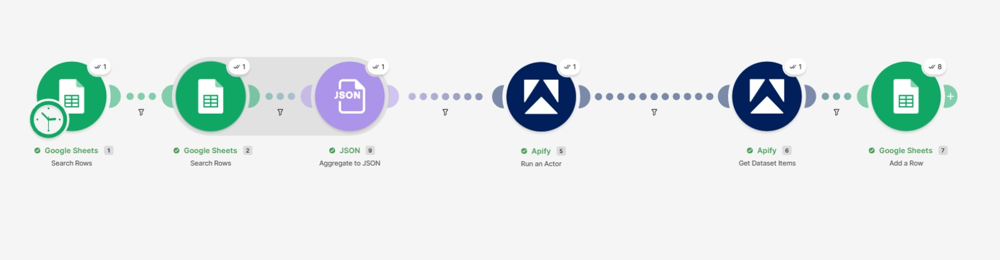

# Simulador de Costos PyME: Producción Nacional vs. Importación

Servicio cloud en **Apify Store** que consolida **Analytics** e **Inferencia de Machine Learning** para ayudar a PyMEs textiles argentinas a decidir si les conviene confeccionar camisas de algodón localmente o importarlas, calculando en tiempo real el **punto de equilibrio por metro de tela** y el **costo esperado de mercado**.

---

## Equipo — TEXTILYTICSTEAM

Proyecto desarrollado en el marco del **Capstone Project — Samsung Innovation Campus (SIC) 2026** (Especialización en Inteligencia Artificial y Ciencia de Datos):

- **Uriel Murua** — Arquitectura Cloud (Apify Actor), Automatización (Make) e Integración de Datos.
- **Valentina Sacco** — Análisis Exploratorio de Datos (EDA), Ingeniería de Features y Modelado Predictivo.
- **Florencia Moreno** — Análisis de Negocio, Validación del Modelo y Visualización (Dashboard Ejecutivo).

---

## Arquitectura e Integración Automatizada (Make + Apify)

El sistema separa completamente el entrenamiento offline (Google Colab) de la inferencia en la nube. El Actor en Apify opera únicamente como motor de predicción y simulación financiera sin estado, sin lógica de reentrenamiento ni iteradores internos:

```text
┌─────────────────────────────────────────────────────────────────────────┐
│                    1. PIPELINE OFFLINE (Google Colab)                   │
│  Scraping ML & Shein ──▶ Limpieza NLP/Regex + IQR Log ──▶ EDA & Corr.   │
│  ──▶ Entrenamiento (GroupKFold + TargetEncoder + Random Forest)         │
│  ──▶ Artefacto serializado: modelos/modelo_costos_camisa.joblib         │
└────────────────────────────────────┬────────────────────────────────────┘
                                     │
                                     ▼
┌─────────────────────────────────────────────────────────────────────────┐
│              2. ORQUESTACIÓN E INFERENCIA CLOUD (Make + Apify)          │
│  [Google Sheets: Parametros + Productos]                                │
│         │                                                               │
│         ▼  (Search Rows + Aggregate to JSON)                            │
│  [Apify Actor: actor-simulador-pyme] (POST sincrónico)                  │
│    ├── src/preprocessing.py    (Alineación de 8 features)               │
│    ├── src/inference.py        (Inferencia Random Forest .joblib)       │
│    └── src/tooling_business.py (Punto de Equilibrio + Decisión PyME)    │
│         │                                                               │
│         ▼  (Get Dataset Items + Key-Value Store)                        │
│  [Google Sheets: Resultados] ──▶ [Dashboard Ejecutivo]                  │
└─────────────────────────────────────────────────────────────────────────┘
```

### Flujo de Automatización en Make.com

1. **Lectura de parámetros (`Google Sheets - Search Rows [1]`):** Lee `tipo_cambio_usd`, `costo_confeccion_ars` y `metros_por_camisa` desde la pestaña `Parametros`.
2. **Lectura de catálogo (`Google Sheets - Search Rows [2]`):** Obtiene los productos nacionales e importados cargados en la pestaña `Productos`.
3. **Empaquetado (`JSON - Aggregate to JSON [9]`):** Consolida todas las filas en un único arreglo JSON válido con las 12 claves esperadas.
4. **Inferencia sincrónica (`Apify - Run an Actor [5]`):** Envía parámetros y registros al Actor `actor-simulador-pyme` en una única llamada (`operacion: "all"`).
5. **Escritura de resultados (`Apify - Get Dataset Items [6]` + `Google Sheets - Add a Row [7]`):** Descarga las predicciones y decisiones económicas y las registra en la pestaña `Resultados`.

---

## Ingeniería de Datos y Metodología (ETL + ML)

### 1. Limpieza y Homologación de Fuentes (ETL)
Se procesaron y estandarizaron dos fuentes heterogéneas bajo una taxonomía textil unificada en español:

- **Dataset Nacional — Mercado Libre (`dataset_telas_limpio_definitivo.csv`):**
  - **Normalización y filtrado:** Reparación de codificación (*mojibake*) y exclusión mediante expresiones regulares de prendas terminadas, artículos de bazar/mercería y telas vendidas por peso (`kg`).
  - **Extracción NLP (Regex):** Identificación en cascada (título, ficha técnica y descripción) de `tipo_tela` (*poplín, batista, lienzo, oxford, tusor, gabardina*, etc.), `fibra` (*algodón, poliéster, mezclas*) y metraje vendido (`metro`), calculando el precio unitario comparable `precio_por_metro`.
  - **Deduplicación y outliers:** Conservación de la publicación más completa por `idPublicacion` y descarte de precios atípicos mediante **filtro IQR sobre escala logarítmica** (`ln(precio_por_metro)`) para respetar la asimetría positiva del mercado.

- **Dataset Importación — Shein (`dataset_shein_limpio_definitivo.csv`):**
  - **Aplanamiento y canal de venta:** Extracción de atributos anidados desde archivos JSON, identificación de `es_marketplace` (`1` = vendedor externo, `0` = marca propia) y filtrado de camisas con género identificable (`Hombre` / `Mujer`).
  - **Homologación bilingüe:** Mapeo de tejidos y fibras del inglés al esquema local (`cotton` -> `algodon`, `twill` -> `sarga`, `flannel` -> `franela`).
  - **Outliers estratificados por género:** Aplicación del filtro **IQR logarítmico por separado para Hombre y Mujer**, evitando que las diferencias de precio entre segmentos distorsionen los umbrales de limpieza.

- **Unificación Comparativa:** Se seleccionaron telas aptas para camisería de fibra **algodón** (`fibra == 'algodon'`) y camisas importadas de algodón, estandarizando la variable objetivo `Costo` en pesos argentinos (`$ ARS`).

### 2. Análisis Exploratorio y Validación Estadística (EDA)
Se evaluó la relación entre las variables predictoras y el costo mediante cinco métricas complementarias:
- **Lineales y monótonas:** Pearson (`r`), Spearman (`rho`) y Kendall (`tau`).
- **No lineales y categóricas:** *Distance Correlation* (`dCor`), Correlación Informacional de Linfoot (`IC`) basada en información mutua, y razón de correlación Eta-cuadrado (`eta^2`).
- **Control de ruido por permutación:** Simulación Monte Carlo permutando la variable objetivo para verificar qué relaciones superan el percentil 95 del ruido aleatorio.

### 3. Entrenamiento y Selección del Modelo (`Random Forest`)
- **Validación sin fuga de datos (*Data Leakage*):** Partición Train/Test (`GroupShuffleSplit` 80/20) y validación cruzada de 5 pliegues (`GroupKFold`) agrupadas por `grupo_id`, garantizando que variantes o scrapes de un mismo artículo no se mezclen entre entrenamiento y prueba.
- **Preprocesamiento integrado en `Pipeline`:**
  - *Categóricas (`Alternativa`, `segmento`, `vendedor`):* Imputación por moda + `TargetEncoder` con validación cruzada interna (`cv=5`), evitando la explosión dimensional de *One-Hot Encoding*.
  - *Numéricas (`Estrellas`, `Cantidad_Resenas`, `Cantidad_Vendida`, `descuento_pct`, `es_marketplace`):* Imputación por mediana + `StandardScaler`.
- **Transformación logarítmica del objetivo:** `TransformedTargetRegressor` (`np.log1p` / `np.expm1`) para estabilizar la varianza y mejorar la precisión relativa en toda la escala de precios.
- **Modelo ganador:** Tras comparar modelos lineales regularizados (`Ridge`) y ensambles de árboles (`Random Forest` y `HistGradientBoosting`), se seleccionó **Random Forest Regressor** (`n_estimators=300`, `max_depth=10`, `min_samples_leaf=5`) y se exportó como `modelos/modelo_costos_camisa.joblib` (`scikit-learn 1.6.1`).

---

## Operaciones Disponibles (`POST` y `GET`)

El Actor consolida ambos servicios de negocio mediante el parámetro `operacion` en un único endpoint:

- **`all` (por defecto):** Ejecuta **Inference + Analytics** en simultáneo. Guarda la tabla fila por fila en el `Dataset` y los KPIs agregados en `RESUMEN_ANALYTICS`.
- **`inference`:** Devuelve únicamente las predicciones unitarias del modelo ML y la decisión económica por producto.
- **`analytics`:** Devuelve únicamente el resumen estadístico agregado de los registros evaluados.

### 1. Ejecutar el servicio (`POST`)
Permite disparar una simulación sincrónica (desde Make, n8n o cualquier cliente HTTP) y obtener los resultados en la misma respuesta:

```bash
curl -X POST "[https://api.apify.com/v2/acts/linkable_oven_urt~actor-simulador-pyme/run-sync-get-dataset-items?token=TU_APIFY_TOKEN](https://api.apify.com/v2/acts/linkable_oven_urt~actor-simulador-pyme/run-sync-get-dataset-items?token=TU_APIFY_TOKEN)" \
  -H "Content-Type: application/json" \
  -d '{
    "operacion": "all",
    "metros_por_camisa": 1.5,
    "costo_confeccion_ars": 8000,
    "tipo_cambio_usd": 1500,
    "registros": [
      {
        "producto": "100% Algodón Por Metro",
        "Alternativa": "Producción Nacional",
        "segmento": "tusor",
        "vendedor": "TELAS.COM",
        "Estrellas": 5,
        "Cantidad_Resenas": 88,
        "precio_por_metro": 9163,
        "metro": 1,
        "Cantidad_Vendida": 1000
      },
      {
        "producto": "Manfinity Solid Long Sleeve Shirt",
        "Alternativa": "Importación (Shein)",
        "segmento": "Men Shirts",
        "vendedor": "Manfinity",
        "Estrellas": 5,
        "Cantidad_Resenas": 1001,
        "precio_venta_usd": 8.75,
        "descuento_pct": 32,
        "Cantidad_Vendida": 300,
        "es_marketplace": 0
      }
    ]
  }'
```

### 2. Consultar documentación y resultados (`GET`)
- **Metadatos y esquema público del Actor:**
  ```bash
  curl -X GET "[https://api.apify.com/v2/acts/linkable_oven_urt~actor-simulador-pyme](https://api.apify.com/v2/acts/linkable_oven_urt~actor-simulador-pyme)"
  ```
- **Resumen ejecutivo agregado (`RESUMEN_ANALYTICS` en Key-Value Store):**
  ```bash
  curl -X GET "[https://api.apify.com/v2/key-value-stores/STORE_ID/records/RESUMEN_ANALYTICS?token=TU_APIFY_TOKEN](https://api.apify.com/v2/key-value-stores/STORE_ID/records/RESUMEN_ANALYTICS?token=TU_APIFY_TOKEN)"
  ```

---

## Formato de Entrada y Salida

### Parámetros de Entrada (`Input`)
| Campo | Tipo | Obligatorio | Default | Descripción |
| :--- | :--- | :---: | :---: | :--- |
| `operacion` | `string` | No | `"all"` | Modo de ejecución: `"all"`, `"inference"` o `"analytics"`. |
| `registros` | `array` | **Sí** | — | Lista de telas nacionales o prendas importadas a evaluar. |
| `metros_por_camisa` | `number` | No | `1.5` | Metros de tela requeridos para confeccionar una camisa. |
| `costo_confeccion_ars` | `integer` | No | `8000` | Costo fijo de taller y mano de obra local por prenda (`$ ARS`). |
| `tipo_cambio_usd` | `number` | No | `1500` | Tipo de cambio de referencia (`$ ARS/USD`) para importación. |

### Ejemplo de Salida (`Dataset` / `Output`)
```json
[
  {
    "producto": "100% Algodón Por Metro",
    "Alternativa": "Producción Nacional",
    "Estrellas": 5,
    "Cantidad_Resenas": 88,
    "precio_por_metro": 9163,
    "metro": 1,
    "Costo_Estimado_ML_ARS": 21745,
    "Costo_Nacional_Simulado_ARS": 21745,
    "Costo_Importacion_Simulado_ARS": null,
    "Punto_Equilibrio_Metro_ARS": null,
    "Decision_PyME": "Producir local a $21,745 ARS (conviene importar solo si prenda < USD 14.50)"
  },
  {
    "producto": "Manfinity Solid Long Sleeve Shirt",
    "Alternativa": "Importación (Shein)",
    "Estrellas": 5,
    "Cantidad_Resenas": 1001,
    "precio_venta_usd": 8.75,
    "descuento_pct": 32,
    "Costo_Estimado_ML_ARS": 14820,
    "Costo_Nacional_Simulado_ARS": null,
    "Costo_Importacion_Simulado_ARS": 13125,
    "Punto_Equilibrio_Metro_ARS": 3416.67,
    "Decision_PyME": "Importar a $13,125 ARS (conviene producir local solo si tela < $3,417/m)"
  }
]
```

---

## Métricas del Modelo y de Negocio

### Desempeño del Modelo Predictivo (`Random Forest`)
Entrenado con validación cruzada agrupada (`GroupKFold`) y evaluado sobre conjunto de prueba independiente (`GroupShuffleSplit` 80/20) sin filtración de precios unitarios:
- **R² (Test):** `0,7004` (explica el 70% de la variabilidad del costo por camisa).
- **MAE (Test):** `$5.128 ARS`
- **RMSE (Test):** `$11.182 ARS`

### Fórmulas de Negocio para la PyME
- **Costo Nacional Simulado:**
  ```text
  Costo_Nacional_Simulado_ARS = (precio_por_metro * metros_por_camisa) + costo_confeccion_ars
  ```
- **Costo Importación Simulado:**
  ```text
  Costo_Importacion_Simulado_ARS = precio_venta_usd * tipo_cambio_usd
  ```
- **Punto de Equilibrio por Metro (`Punto_Equilibrio_Metro_ARS`):** Indica el precio máximo que la PyME puede pagar por metro de tela nacional para empatar el costo de importar la prenda terminada:
  ```text
  Punto_Equilibrio_Metro_ARS = (Costo_Importacion_Simulado_ARS - costo_confeccion_ars) / metros_por_camisa
  ```

---

## Consumo de Recursos y Propuesta Comercial (Apify Store)

### Medición Real de Infraestructura (Benchmark en Apify)
| Métrica Operativa | Valor Medido |
| :--- | :--- |
| **Memoria asignada / Pico real** | `512 MB` (`0,5 GB`) / `119,7 MB` pico (`33,4 MB` promedio) |
| **Tiempo total de ejecución** | `7 segundos` (`~1,2 s` de inferencia Python efectiva) |
| **Consumo de Compute Units (CU)** | `0,00097 CU` por ejecución (`0,5 GB × 7 s / 3600 s`) |
| **Costo real de infraestructura** | **~$0,0003 USD** por ejecución |

### Modelo de Monetización Sugerido
Dado el bajo consumo de cómputo (`< 0,001 CU` por corrida) y el impacto directo en la rentabilidad de compras textiles:
- **Modelo Pay-Per-Event (PPE) en Apify Store:**
  - **Nivel Gratuito / Prueba:** Primeras `20 ejecuciones` sin cargo para validación con datos propios de la PyME.
  - **Precio Comercial:** **`$0,05 USD` por ejecución** (hasta 500 registros por consulta).
  - **Rentabilidad Bruta:** Frente a un costo operativo de `$0,0003 USD` por corrida (más comisiones de plataforma), mantiene un **margen operativo superior al 95%**, resultando accesible para cualquier taller o comercio textil (`~$2,50 USD/mes` en corridas semanales).

---

## Estructura del Repositorio

```text
├── .actor/
│   ├── actor.json                       # Configuración y metadatos del Actor en Apify
│   └── input_schema.json                # Esquema de validación de parámetros de entrada
├── docs/
│   └── flujo.png                        # Captura del flujo conectado en Make.com
├── modelos/
│   └── modelo_costos_camisa.joblib      # Pipeline entrenado (Random Forest + TargetEncoder)
├── src/
│   ├── __main__.py                      # Punto de ejecución del paquete Python
│   ├── config.py                        # Constantes y rutas del modelo serializado
│   ├── main.py                          # Entrypoint asíncrono del Actor en Apify
│   ├── preprocessing.py                 # Limpieza y alineación de las 8 features de entrada
│   ├── inference.py                     # Carga del .joblib y ejecución de predicciones
│   ├── tooling_business.py              # Simulación financiera, punto de equilibrio y KPIs
│   └── salidas.py                       # Escritura en Dataset y Key-Value Store de Apify
├── Dockerfile                           # Imagen base Python para despliegue en Apify Cloud
├── requirements.txt                     # Dependencias (scikit-learn==1.6.1, pandas, numpy, joblib)
└── README.md                            # Documentación principal del proyecto
```
